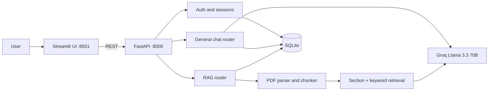

# Bot-GPT: Conversational AI with Document-Grounded Q&A

[](https://github.com/poojabhather99/bot-gpt/actions/workflows/ci.yml)


A multi-user chat assistant with two modes: **general Q&A** with long-conversation memory, and **RAG mode**, where answers come strictly from PDFs the user uploads. Built with FastAPI, Groq (Llama 3.3 70B), SQLite and a Streamlit UI, and shipped as two Docker containers.

## Features

- **Authentication:** registration and login with bcrypt-hashed passwords and 7-day expiring sessions.
- **General chat:** rolling conversation window; once history exceeds 10 messages, older turns are summarised by the LLM and carried forward, so long chats stay within context limits.
- **Document Q&A (RAG):** upload a PDF and ask questions answered only from its content, returned as structured JSON and validated before use.
- **Layout-aware PDF parsing:** detects two-column pages and extracts text in reading order with `pdfplumber`.
- **Document-type-aware chunking:** classifies a PDF as resume, research paper or general report, then chunks by section headers (resume or research) or by paragraph (report).
- **Persistent history:** chats, messages, summaries and documents are stored per user and reload on login.
- **Operations:** `/health` endpoint, container health checks, CI that runs tests and smoke-tests the built image.

## Architecture



### How retrieval works

1. The PDF is parsed page by page and its document type is detected from signal phrases in the first two pages.
2. Chunks are created per section (resume, research) or per paragraph (report).
3. For each question, chunks are scored in two passes: +10 when the chunk's section matches the intent of the question (for example "skills" maps to the SKILLS section), plus 1 per matching query word. The top 5 chunks go to the model as context.
4. If nothing scores above zero, the full document is passed instead of guessing.

This is deliberately lightweight (no vector database) and works well for structured documents. Replacing the scoring step with embeddings is listed under roadmap.

## Project structure

```
apis/
  main.py               FastAPI app, auth and user routes, /health
  general_question.py   general chat router, history and summarisation
  rag_question.py       PDF parsing, chunking, retrieval, RAG router
app/
  auth.py               bcrypt hashing, session creation and validation
  chat_store.py         chats, messages and summaries persistence
  database.py           SQLite connection and schema
ui/ui_main.py           Streamlit frontend
tests/test_core.py      unit tests (auth, JSON parsing, chunking, retrieval)
Dockerfile              API image
Dockerfile.streamlit    UI image
docker-compose.yml      API + UI with a persistent volume
.github/workflows/ci.yml  tests, image builds, container smoke test
```

## Quickstart

### With Docker

```bash
git clone https://github.com/poojabhather99/bot-gpt.git
cd bot-gpt
cp .env.example .env        # then add your GROQ_API_KEY
docker compose up --build
```

- API and interactive docs: http://localhost:8000/docs
- UI: http://localhost:8501

### Without Docker

```bash
python -m venv venv && source venv/bin/activate
pip install -r requirements.txt
cp .env.example .env        # then add your GROQ_API_KEY

uvicorn apis.main:app --reload --port 8000
streamlit run ui/ui_main.py
```

### Tests

```bash
python -m pytest tests/ -v
```

## Configuration

| Variable | Description | Default |
|---|---|---|
| `GROQ_API_KEY` | Groq API key (required) | none |
| `DB_PATH` | SQLite database file | `qa_assistant.db` |
| `API_URL` | Backend URL used by the Streamlit UI | `http://127.0.0.1:8000` |

## API overview

| Method | Endpoint | Description |
|---|---|---|
| POST | `/auth/register` | Create an account |
| POST | `/auth/login` | Log in and receive a session id |
| GET | `/auth/me` | Current user |
| POST | `/general/ask` | General Q&A |
| GET | `/general/history/{session_id}/{chat_id}` | Chat history |
| POST | `/document/upload` | Upload a PDF |
| POST | `/document/ask` | Ask a question about an uploaded PDF |
| GET | `/document/list` | List documents |
| GET | `/user/chats` | Paginated chat list |
| GET | `/user/documents` | User's documents |
| GET | `/conversations/{chat_id}` | Load a conversation |
| DELETE | `/conversations/{chat_id}` | Delete a conversation |
| GET | `/health` | Health check |

## Roadmap

- Replace keyword scoring with embeddings and a vector store, and compare retrieval quality against the current approach.
- Add a small evaluation set (question, expected answer, source chunk) to measure answer faithfulness.
- Add rate limiting, and move from SQLite to PostgreSQL for multi-instance deployment.
- Stream responses to the UI.

## License

MIT
